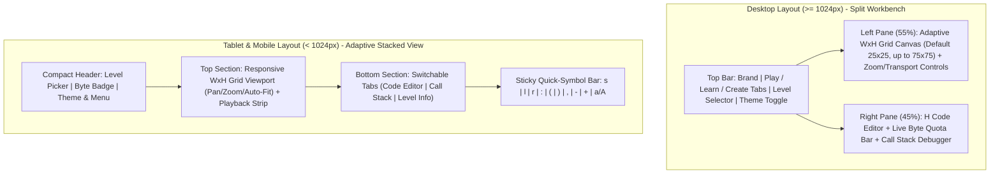
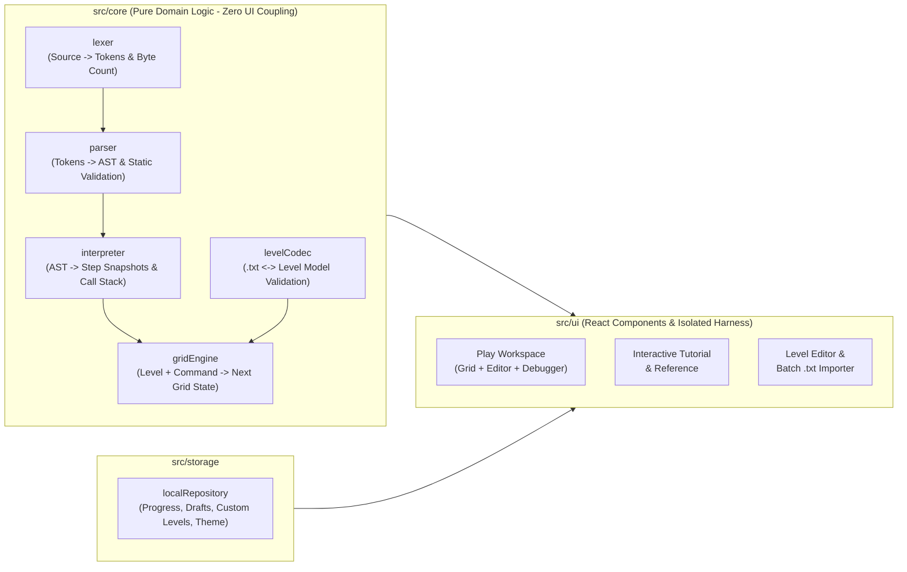

# XHerbert - Product Requirements Document (PRD)

- **Product Name**: XHerbert
- **Production URL**: `https://xherbert.maxithome.com`
- **Deployment Platform**: Cloudflare Pages (Pure Static SPA)
- **Target Audience**: Teenagers (ages 12-18), programming & algorithm beginners, computer science educators, and puzzle enthusiasts
- **UI Language**: English Only (`en-US`)
- **Core Reference Specification**: [README.md](file:///Users/victorxu/projects/herbert/README.md)

---

## 1. Product Vision & Positioning

**XHerbert** is a modern, browser-based algorithmic programming puzzle game inspired by the classic *Herbert* challenge from the 2007-2008 Microsoft Imagine Cup Algorithm Invitational.

Built entirely as a zero-backend client-side application, XHerbert brings the authentic **H programming language**, the **grid physics** (defaulting to $25 \times 25$ and supporting flexible odd-dimension rectangular maps up to $75 \times 75$), and the **token-based byte-counting rules** defined in [README.md](file:///Users/victorxu/projects/herbert/README.md) to a new generation of young learners (ages 12-18). By combining a sleek Light/Dark responsive interface with visual recursion debugging, an interactive onboarding tutorial, and a full-featured custom level editor, XHerbert transforms abstract concepts - such as procedures, numerical recursion, higher-order macro arguments, and code optimization - into an intuitive, tactile game experience.

---

## 2. Target Audience & User Personas

| Persona | Age / Role | Goals & Needs | Key Pain Points Addressed by XHerbert |
| :--- | :--- | :--- | :--- |
| **Alex (The Curious Beginner)** | 12-15 years old, middle/high school student | Wants to play immediately without sign-up walls; needs a visual, step-by-step way to understand how functions and recursion actually move the robot. | Provides a 5-minute interactive tutorial, visual step-by-step execution, and a live call-stack inspector that demystifies recursion. |
| **Maya (The Algorithm Challenger)** | 15-18 years old, competitive programming student | Wants to solve complex geometric puzzles (Windmill, Stairway) using the minimum possible bytes (`Code Golf`) on both desktop and mobile/tablet. | Features a live token-level Byte Counter, step-back debugging, and a dedicated mobile quick-symbol bar that prevents mobile keyboard auto-capitalization issues. |
| **Mr. Carter (CS Educator / Creator)** | High school CS teacher / club mentor | Wants to design custom levels visually (from standard $25 \times 25$ up to $75 \times 75$ or rectangular grids), batch-upload `.txt` level packs for classroom exercises, and export levels easily. | Offers a built-in visual Level Editor supporting odd dimensions in $[25, 75]$ with instant test-play, plus batch `.txt` import and export. |

---

## 3. Core Product Principles

1. **100% Authentic Ruleset + Flexible Map Dimensions**: Strictly implements the grid physics, immediate victory condition, non-positive ($\le 0$) numeric parameter termination, lexical command-sequence substitution, and token byte-counting specification from [README.md](file:///Users/victorxu/projects/herbert/README.md), while extending map dimensions from the default $25 \times 25$ to any odd width $W \in [25, 75]$ and odd height $H \in [25, 75]$ (supporting both square and non-square rectangular maps).
2. **Zero Friction, Privacy-First**: No login, no account creation, no tracking cookies, and no backend server required. All progress and custom levels persist locally in the user's browser.
3. **Visualizing the Abstract**: Every execution step links the robot's physical movement on the $W \times H$ grid to the exact character in the H source code and the active frame in the recursion call stack.
4. **Cross-Device Ergonomics**: Equally playable on a desktop monitor with a mechanical keyboard, an iPad in a classroom, or a smartphone on the go.

---

## 4. Functional Requirements

### 4.1 Core Gameplay & Coding Workspace (`Play Mode`)

#### 4.1.1 Adaptive $W \times H$ Grid Simulation Canvas
- **Flexible Odd-Dimension Grid Specification**:
  - **Default Size**: $25 \times 25$ ($W = 25, H = 25$).
  - **Supported Dimension Range**: Both Width ($W$, number of columns) and Height ($H$, number of rows) must satisfy:
    - $25 \le W \le 75$ and $W \bmod 2 = 1$ (odd integers: $25, 27, 29, \dots, 73, 75$)
    - $25 \le H \le 75$ and $H \bmod 2 = 1$ (odd integers: $25, 27, 29, \dots, 73, 75$)
  - **Rectangular & Square Support**: Width and Height are independent ($W = H$ for square maps, or $W \neq H$ for rectangular maps such as $35 \times 25$ or $25 \times 51$). Requiring odd integers guarantees an exact center column $((W-1)/2)$ and center row $((H-1)/2)$ on every valid map.
- **Viewport Rendering, Zoom & Camera Controls**:
  - Renders the $W \times H$ orthogonal grid with crisp, scalable vector/canvas graphics that auto-fit any rectangular aspect ratio within the viewport.
  - For larger grids (e.g., $51 \times 51$ or $75 \times 75$) or small mobile screens, provides smooth **Zoom (`100% Fit`, `Zoom In/Out`)**, **Pan/Drag**, and an optional **"Follow Herbert" Camera Mode** so the robot and nearby cells remain clearly visible.
- **Entity Rendering & States**:
  - **Empty Space (`.`)**: Subtle grid cell with optional coordinate rulers ($0$ to $W-1$ horizontally, $0$ to $H-1$ vertically) on the outer border.
  - **Start & Robot (`u`, `r`, `d`, `l`)**: Renders **Herbert** with a clear directional indicator (Up/North, Right/East, Down/South, Left/West) and smooth interpolation between steps.
  - **Wall (`*`)**: High-contrast obstacle block. When Herbert steps into a wall or grid boundary (`s`), plays a subtle bump animation without changing coordinates or orientation, incrementing the step counter by 1.
  - **White Button (`w`)**: Target button with distinct **Unpressed** (hollow/dimmed) and **Pressed/Lit** (glowing/filled) visual states. Stepping on an already-lit white button keeps it lit.
  - **Gray Button (`g`)**: Reset trap with a distinct warning visual style. Stepping on a gray button triggers a visual ripple/reset feedback and immediately reverts all currently lit white buttons back to the unpressed state.
- **Immediate Win Detection**: After every step, if $W_{\text{lit}} = W_{\text{total}}$, execution halts immediately and triggers the Level Solved summary.

#### 4.1.2 H Language Code Editor & Hybrid Input System
- **Syntax Highlighting**: Distinguishes primitive commands (`s`, `l`, `r`), procedure names (`a-z`), parameters (`A-Z`), integer constants (`0-9`), and free punctuation (`: ( ) , + -`).
- **Auto-Correction Suppression**: Explicitly disables browser `autocapitalize`, `autocomplete`, `autocorrect`, and `spellcheck` so mobile/tablet virtual keyboards never corrupt case-sensitive H identifiers.
- **Mobile/Tablet Quick-Symbol Bar (Hybrid Input)**:
  - On touch devices (or toggleable on desktop), displays a compact, single-tap toolbar directly above the virtual keyboard containing:
    - Core primitives: `s`, `l`, `r`
    - Syntax & operators: `:`, `(`, `)`, `,`, `-`, `+`
    - Quick case-toggle (`a <-> A`), common identifiers (`a`, `b`, `c`, `X`, `Y`, `1`), Backspace, and Newline.

#### 4.1.3 Live Byte Counter & Scoring HUD
- **Real-Time Token Byte Calculation**:
  - Computes program size in real time according to the official rules:
    - `1 Byte`: Each command (`s`, `l`, `r`), each procedure name (`a-z` in definition or call), each parameter (`A-Z` in declaration or reference), and each contiguous integer literal (e.g., `1`, `15`, `255` each cost `1 Byte`).
    - `0 Bytes (Free)`: Punctuation (`:`, `(`, `)`, `,`), operators (`+`, `-`), and whitespace/newlines.
- **Visual Byte Breakdown**:
  - Displays a live quota bar: `Bytes: B / M` (where $M$ is `max_bytes`).
  - Color-codes the quota bar:
    - **Optimal / Under Budget ($B < M$)**: Emerald green (shows efficiency bonus preview).
    - **At Limit ($B = M$)**: Amber/Blue.
    - **Over Budget ($B > M$)**: Crimson red warning (`Size Limit Exceeded - 0 pts if run`).
  - Hovering or tapping the byte counter shows a token-by-token highlight in the editor so beginners immediately see why punctuation and multi-digit numbers are free/compact.
- **Scoring Engine**:
  - Displays live and post-run score breakdown:
    - **Over Byte Limit ($B > M$)**: $0$ points.
    - **Partial Completion ($B \le M, W_{\text{lit}} < W_{\text{total}}$)**: Proportional partial points based on $\lfloor P_{\text{base}} \times (W_{\text{lit}} / W_{\text{total}}) \times 0.5 \rfloor$.
    - **Solved ($B \le M, W_{\text{lit}} = W_{\text{total}}$)**: Full level base points $P_{\text{base}}$ + **Byte-Saving Bonus** proportional to $(M - B)$.

#### 4.1.4 Execution Playback & Visual Debugger
- **Transport Controls**:
  - **Run / Pause**: Continuous execution at user-selected speed.
  - **Step Forward (`>|`)**: Executes exactly 1 primitive command (`s`, `l`, or `r`) and pauses.
  - **Step Backward (`|<`)**: Reverts 1 step backward using state snapshots, restoring Herbert's position, orientation, button states, and call stack frame.
  - **Instant Run (`>>|`)**: Executes the program at maximum speed up to victory or `MAX_STEPS` to quickly verify long trajectories.
  - **Reset**: Resets Herbert and all buttons to initial state at Step 0.
  - **Speed Selector**: `1x`, `2x`, `5x`, `20x`, `Max`.
- **Visual Call Stack & Active Token Inspector**:
  - Highlights the exact command or procedure call currently executing in the editor.
  - Displays a live **Call Stack Panel** showing active stack frames (e.g., `main -> b(X=3) -> a(X=2)`) and the current bound values of parameters (`A-Z`), whether they hold an integer (e.g., `X = 2`) or a command sequence (e.g., `Y = ssl`).
  - Visually indicates when a procedure call is skipped due to the **Non-Positive Termination Rule ($\le 0$)** (e.g., `a(0) -> skipped (<= 0)`), helping beginners grasp recursion base cases effortlessly.

---

### 4.2 Campaign Level Browser & Progression

- **All Levels Unlocked by Default**: All built-in levels are immediately accessible without artificial paywalls or forced linear locks, allowing students and teachers to jump to any topic.
- **Structured Learning Chapters (Recommended Path)**:
  1. **Chapter 1: First Steps & Procedures** - Basic movement (`s`, `l`, `r`), walls, gray button traps, and parameterless procedures (`a:ssla`).
  2. **Chapter 2: Counting & Numeric Recursion** - Single and multi-parameter numeric recursion (`a(X):sa(X-1)`), countdowns, and spirals.
  3. **Chapter 3: Higher-Order Macros** - Passing command sequences as arguments (`a(X):XX`, `a(X):Xra(Xs)`), exponential step doublers, and alternating parameters.
  4. **Chapter 4: Imagine Cup Classics** - Iconic competition levels (*Corners*, *Diamond*, *Snake*, *Windmill*, *Stairway*, etc.) that test wall alignment and strategic gray-button resets.
- **Level Card Metadata**: Each level card shows a miniature map preview, difficulty badge, `max_bytes` ($M$), base points ($P$), and the user's personal best record (`Solved`, `Best Bytes`, `Best Score`).

---

### 4.3 Interactive Quick-Start Tutorial & Reference (`Learn Mode`)

Designed specifically for 12-18 year-old beginners to master H in under 5 minutes:

1. **Interactive 5-Stage Guided Walkthrough**:
   - **Lesson 1: Meet Herbert** - Moving forward (`s`), turning (`l`, `r`), and lighting up White Buttons (`w`).
   - **Lesson 2: Obstacles & Traps** - Bumping into Walls (`*`) harmlessly (and using walls to align!) vs. avoiding Gray Buttons (`g`) that reset your progress.
   - **Lesson 3: Procedures & Infinite Loops** - Defining `a:ssra` and discovering that levels finish the exact instant the last white button is lit.
   - **Lesson 4: The Secret of Numbers ($\le 0$ Stops!)** - How `a(X):sa(X-1)` works without an `if` statement.
   - **Lesson 5: Passing Code as Data & Byte Golfing** - Using `a(X):XX` to double movements and learning which characters cost `1 Byte` vs. `0 Bytes`.
2. **Slide-Out H Language Cheat Sheet**:
   - Accessible from any screen via a `? Reference` button without losing current editor code.
   - Summarizes commands, grammar rules, byte counting table, and the 4 classic algorithmic idioms.

---

### 4.4 Custom Level Editor & Batch `.txt` Import/Export (`Create Mode`)

#### 4.4.1 Visual $W \times H$ Grid Editor ($25 \le W, H \le 75$, Odd Dimensions)
- **Grid Dimension Controls**:
  - **Default Canvas Size**: $25 \times 25$ ($W = 25, H = 25$).
  - **Custom Width & Height Selectors**: Users can independently adjust **Width ($W$, columns)** and **Height ($H$, rows)** across all odd integers from `25` to `75` (`25, 27, 29, ..., 73, 75`).
  - **Non-Square Rectangular Maps**: Supports both square ($W = H$) and rectangular ($W \neq H$, e.g., $45 \times 25$ or $25 \times 61$) layouts. Resizing the canvas preserves existing painted cells anchored from the center or top-left and automatically regenerates outer perimeter walls if requested.
- **Drawing Tools**:
  - **Palette**: Empty (`.`), Wall (`*`), White Button (`w`), Gray Button (`g`), and Start Position (`u`, `r`, `d`, `l`).
  - **Brush Modes**: Single Cell / Drag-to-Paint, Line Tool, Rectangle Fill/Outline, Eraser, Clear All, and Reset Outer Perimeter Walls.
  - **Symmetry Toggle (Optional Helper)**:
    - Horizontal, Vertical, and 180-degree Point Symmetry (available on all odd $W \times H$ maps, anchored around the exact center cell $((W-1)/2, (H-1)/2)$).
    - 4-way Rotational Symmetry (enabled whenever $W = H$).
- **Level Metadata Form**:
  - `Level Name` (e.g., `"Spiral Fortress"`)
  - `Grid Dimensions` ($W \times H$, odd integers in $[25, 75]$, default $25 \times 25$)
  - `Max Bytes` ($M$, integer $1 - 999$)
  - `Base Points` ($P$, integer $10 - 10000$)
- **Live Validation & Test-Play**:
  - Enforces that a valid level has:
    1. Odd width $W \in [25, 75]$ and odd height $H \in [25, 75]$ (with all $H$ rows having uniform length $W$);
    2. **Exactly one** starting position (`u`, `r`, `d`, or `l`);
    3. **At least one** white button (`w`).
  - **"Test & Calibrate" Button**: Opens the level directly in the simulator so the creator can write a reference solution, verify solvability, and optionally click *"Set my solution's byte count as Max Bytes"*.

#### 4.4.2 Batch `.txt` Level Upload & Export
- **Standard `.txt` File Format Specification**:
  Supports both **Pure Grid `.txt` files** (defaulting to $25 \times 25$ as in [README.md](file:///Users/victorxu/projects/herbert/README.md#L204-L234), or any odd $W \times H$ matrix where $25 \le W, H \le 75$) and **Annotated `.txt` files** with optional header/footer metadata comments:
  ```text
  # name: Classic Cross
  # max_bytes: 18
  # points: 200
  *************************
  *.......................*
  *..w.................w..*
  ... (H rows of W chars: ., *, w, g, u/r/d/l; default 25x25, odd W,H in [25,75]) ...
  *************************
  ```
  *(If metadata headers are omitted in an uploaded `.txt` file, the importer automatically infers $W$ and $H$ from the grid lines, derives the level name from the filename, and assigns sensible defaults for `max_bytes` and `points`, which the user can edit).*
- **Dimension & Schema Validation on Upload**:
  - Verifies that the number of grid rows $H$ satisfies $25 \le H \le 75$ and $H \bmod 2 = 1$.
  - Verifies that every grid row has the exact same character length $W$, where $25 \le W \le 75$ and $W \bmod 2 = 1$.
  - Rejects files with even dimensions, out-of-range dimensions ($< 25$ or $> 75$), ragged row lengths, invalid characters, missing/duplicate start positions, or zero white buttons, reporting clear diagnostic messages per file.
- **Batch Upload (Import)**:
  - Drag-and-drop zone or file picker accepting multiple `.txt` files simultaneously (`.txt` multi-file selection).
  - Parses and validates each file in the batch, displaying an import summary (valid levels with their detected $W \times H$ dimensions added to "My Custom Levels" vs. malformed files with specific line/dimension/character error messages).
- **Batch Download (Export)**:
  - Export a single custom level as `<level-slug>.txt`.
  - Select multiple (or all) custom levels to batch-export as individual `.txt` files or a combined level pack.

---

### 4.5 Local Persistence Architecture (No Backend)

All user data is stored purely in the browser via a versioned storage schema (`localStorage` / `IndexedDB`):
1. **User Preferences**: Theme selection (`light` | `dark` | `system`), playback speed preference, coordinate ruler toggle, tutorial completion status.
2. **Campaign Progress & Solutions**: For each level ID, stores current draft code, best solved code, best byte count ($B_{\text{best}}$), and highest score achieved.
3. **Custom Level Repository**: Stores user-created and batch-imported levels with creation/modification timestamps.

---

## 5. UI/UX Layout & Responsive Design Specification

### 5.1 Theme System (Light & Dark Mode)

| Surface / Element | Light Theme (Daylight Classroom) | Dark Theme (Cyber Grid Studio) |
| :--- | :--- | :--- |
| **App Background** | `#F8FAFC` (Slate 50) | `#0B0F19` (Deep Slate 950) |
| **Panel / Card Surface** | `#FFFFFF` with `#E2E8F0` border | `#111827` with `#1F2937` border |
| **Grid Floor (`.`)** | `#F1F5F9` with `#CBD5E1` gridlines | `#1E293B` with `#334155` gridlines |
| **Wall (`*`)** | `#334155` (textured slate block) | `#475569` (beveled dark block) |
| **White Button (`w`) - Unpressed** | `#FFFFFF` circle with `#0EA5E9` ring | `#E2E8F0` circle with `#38BDF8` ring |
| **White Button (`w`) - Pressed/Lit** | `#10B981` (Vibrant Emerald Glow) | `#34D399` (Neon Emerald Glow) |
| **Gray Button (`g`) - Reset Trap** | `#64748B` octagonal/hazard tile with `#EF4444` accent | `#475569` hazard tile with `#F87171` warning ring |
| **Herbert Robot (`u/r/d/l`)** | `#2563EB` (Royal Blue directional bot) | `#60A5FA` (Bright Sky Blue directional bot) |

### 5.2 Multi-Device Responsive Breakpoints



1. **Desktop ($\ge 1024\text{px}$)**:
   - Side-by-side IDE workbench layout. No page scrolling required; the $W \times H$ grid (default $25 \times 25$, or any odd rectangular/square size up to $75 \times 75$) scales dynamically to fit the available container while preserving cell squareness, with smooth pan/zoom controls.
2. **Tablet ($768\text{px} - 1023\text{px}$)**:
   - Adaptive two-column or collapsible split layout with touch targets $\ge 44 \times 44\text{px}$, pinch-to-zoom/pan on the grid canvas, and the Quick-Symbol Bar enabled for touch typing.
3. **Mobile ($< 768\text{px}$)**:
   - Stacked vertical layout where the $W \times H$ canvas occupies the top viewport (with auto-fit and "Follow Herbert" camera mode for larger maps) and the code editor / debugger occupies the bottom half, paired with the sticky Quick-Symbol Bar for effortless one-handed or two-thumb coding.

---

## 6. Technical Architecture & Engineering Standards

### 6.1 Technology Stack
- **Frontend Framework**: React 19 + TypeScript (Strict Mode)
- **Build Tool**: Vite
- **Styling**: Tailwind CSS (with CSS variables for instant Light/Dark switching)
- **Icons**: Lucide React
- **Testing & Quality Gates**:
  - **Unit & Integration Testing**: Vitest + React Testing Library ($\ge 90\%$ coverage)
  - **Mutation Testing**: StrykerJS ($\ge 85\%$ mutation score on core modules)
  - **End-to-End (E2E) Browser Testing**: Playwright (verifying Desktop, Tablet, and Mobile viewports)
- **Deployment**: Cloudflare Pages connected to GitHub repository, custom domain `xherbert.maxithome.com`.

### 6.2 Modular Architecture

To satisfy strict modularity, testability, and decoupling requirements, the codebase is organized into independent modules with explicit input/output contracts:



1. **`src/core/lexer`**: Tokenizes H source code, computes exact token byte count (`1 Byte` vs `0 Byte` tokens), and maps every token to its character range for UI highlighting.
2. **`src/core/parser`**: Parses tokens into an immutable Abstract Syntax Tree (AST) and performs static validation (undefined procedures, duplicate definitions, parameter arity mismatches, undeclared parameters, type mismatches).
3. **`src/core/interpreter`**: Evaluates the AST using call-by-value numeric expressions (enforcing $[-255, +255]$ range and $\le 0$ termination) and lexical substitution for command-sequence arguments, yielding deterministic step-by-step execution frames for forward/backward debugging.
4. **`src/core/gridEngine`**: Manages the $W \times H$ board state (default $25 \times 25$, supporting any odd $W, H \in [25, 75]$), robot position/orientation, wall collisions, white button activation, gray button resets, immediate win detection, and score calculation.
5. **`src/core/levelCodec`**: Parses and serializes `.txt` level files (both single and batch), validating that grid dimensions $W$ and $H$ are odd integers within $[25, 75]$ and all rows have uniform width $W$.
6. **CLI & Isolated Manual Verification**: Each core module exposes a clean TypeScript API and CLI runner (invocable via `uv run` / Node CLI bridge) and isolated UI harness modes for standalone verification.
